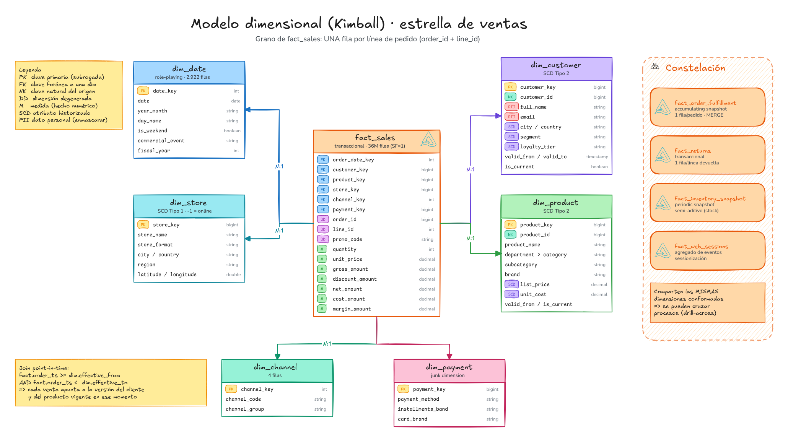
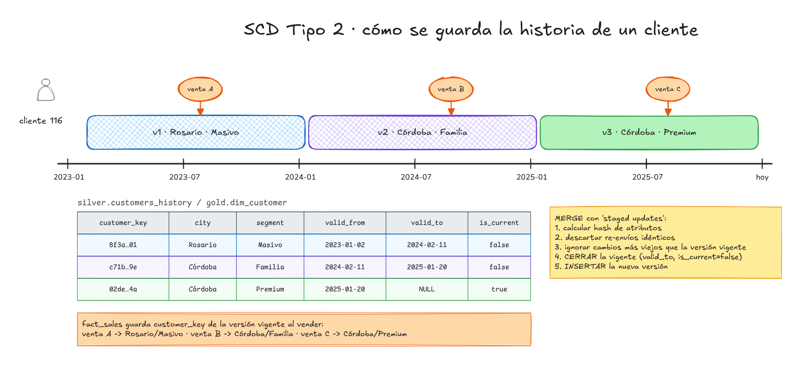
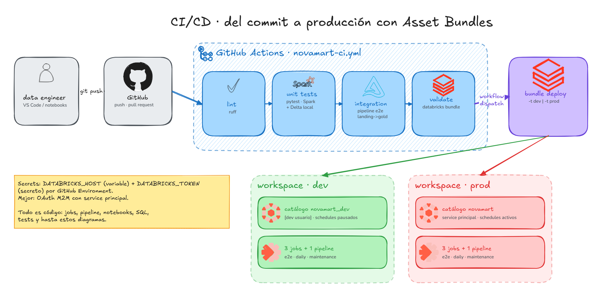

# 🛒 NovaMart Lakehouse

**Proyecto end-to-end en Databricks para aprender Spark, SQL y modelado de datos con grandes volúmenes.**

Un retailer omnicanal ficticio (6 países de LatAm, ~400 tiendas, web, app y marketplace) genera
**cientos de millones de filas**: pedidos, clickstream, CDC de clientes y productos, logística,
devoluciones e inventario. El proyecto las lleva desde archivos crudos hasta un modelo dimensional
listo para BI, con calidad de datos, historia (SCD2), orquestación, CI/CD y una ruta de aprendizaje
de 18 módulos que usa **esos mismos datos**.


<p align="center">


</p>

---

## ¿Qué tiene este proyecto?

| Área | Qué vas a encontrar |
|---|---|
| **Volumen real** | Generador distribuido en Spark con `scale_factor`: SF=1 ≈ 12M pedidos, 36M líneas, 150M eventos web, 157M filas de stock (~30 GB). SF=10 ≈ 10x. |
| **Datos sucios a propósito** | duplicados, re-envíos, nulos, cantidades negativas, 3 formatos de fecha, epoch en ms, emails/teléfonos sucios, llegadas tardías, *schema drift*. |
| **Medallion** | `landing` (UC Volume) → `bronze` (Auto Loader) → `silver` (limpieza, calidad, SCD2) → `gold` (estrella Kimball + marts SQL). |
| **Modelado** | 6 dimensiones (2 SCD2, junk, role-playing) + los 4 tipos de facts de Kimball + matriz de bus + vista OBT. |
| **Incrementalidad** | checkpoints, `availableNow`, `foreachBatch` + MERGE, watermarks, `replaceWhere` por fechas afectadas. Re-ejecutar es idempotente. |
| **Calidad** | framework de reglas (warn/quarantine/fail), `ops.quarantine`, `ops.dq_results`, quality gate que falla el job. |
| **Dos implementaciones** | imperativa (`src/` + notebooks + Job) y declarativa (Lakeflow Declarative Pipelines en SQL, `AUTO CDC`). |
| **Producción** | Databricks Asset Bundle (3 jobs + 1 pipeline), `for_each_task`, `condition_task`, `run_job_task`, diseño físico (liquid clustering, PK/FK, tags PII). |
| **Ingeniería** | paquete Python testeable, 13 tests (unitarios + e2e con Spark/Delta local), GitHub Actions, ruff. |
| **Aprendizaje** | [18 módulos](learning/README.md) de SQL, Spark, Delta, streaming, modelado, gobierno y CI/CD con ejercicios y soluciones. |
| **Diagramas** | 9 diagramas Excalidraw con iconos de librerías oficiales + animaciones Excalimate (`.excanim`) y GIF. |

## Arquitectura

| | |
|---|---|
|  |  |
| **Linaje**: cada archivo → cada tabla | **Modelo estrella** de ventas + constelación |
|  |  |
| **SCD Tipo 2** paso a paso | **Ejecución de Spark**: shuffle, skew, broadcast |
|  |  |
| **Lakeflow Job** (DAG) | **CI/CD** con GitHub Actions + DAB |

Más detalle en [`docs/`](docs/): [arquitectura](docs/01_arquitectura.md) ·
[fuentes y diccionario de datos](docs/02_fuentes_y_datos.md) · [modelado](docs/03_modelado_de_datos.md) ·
[performance y volumen](docs/04_performance_y_volumen.md) · [despliegue](docs/05_despliegue.md) ·
[diagramas](docs/diagrams/README.md).

## Inicio rápido

### Opción A — Databricks (recomendado)

Funciona en **Databricks Free Edition** (serverless) con `scale_factor=0.1`, o en cualquier workspace con Unity Catalog.

```bash
# Databricks CLI (v0.2xx+): brew install databricks  |  winget install Databricks.DatabricksCLI
# o: curl -fsSL https://raw.githubusercontent.com/databricks/setup-cli/main/install.sh | sh
databricks auth login --host https://<tu-workspace>.cloud.databricks.com
cd novamart-lakehouse
databricks bundle deploy -t dev
databricks bundle run novamart_e2e -t dev            # pipeline completo (~15-25 min con SF=0.1)
databricks bundle run novamart_daily -t dev          # simula que llega un día nuevo
```

Sin CLI: clonar el repo como **Git folder** en el workspace y ejecutar en orden los notebooks
`notebooks/00_setup` → `07_data_quality_report` (widget `catalog`; en Free Edition usá `workspace` si no podés crear catálogos).

### Opción B — Local (Spark + Delta OSS, sin Databricks)

```bash
cd novamart-lakehouse
python -m venv .venv && source .venv/bin/activate
pip install -e ".[dev]"                      # requiere Java 17+
python scripts/run_local.py --scale-factor 0.002 --start 2025-01-01 --end 2025-03-31
python scripts/run_local.py --increment 2025-04-01   # carga incremental de un día nuevo
pytest -m "not integration"                  # tests unitarios (~1 min)
pytest -m integration                        # pipeline e2e completo + incremental (~10 min)
```

Resultado de una ejecución local real (SF=0.002, 3 meses):

| capa | tabla | filas |
|---|---|---:|
| bronze | web_events | 278.626 |
| bronze | order_status_events | 83.792 |
| silver | order_lines | 56.385 |
| silver | orders (dedup: 24.070 → 23.985) | 23.985 |
| gold | fact_sales (= grano de order_lines) | 56.385 |
| gold | fact_web_sessions | 50.002 |
| ops | quarantine (cliente nulo online, cantidad ≤ 0) | 35 |

## Estructura del repositorio

```
novamart-lakehouse/
├── databricks.yml                 # Asset Bundle: targets dev / prod, variables
├── resources/                     # jobs (e2e, diario, mantenimiento) + pipeline declarativo
├── src/novamart/
│   ├── config.py                  # catálogo/esquemas, rutas, scale factor
│   ├── datagen/                   # generador distribuido (8 fuentes, ruido, estacionalidad)
│   ├── ingestion/bronze.py        # Auto Loader / file streaming
│   ├── silver/                    # transforms puras, reglas, SCD2, cargas foreachBatch
│   ├── gold/                      # dimensiones, facts, runner de marts SQL
│   ├── quality/                   # framework de expectations + cuarentena
│   ├── utils/                     # spark, delta (MERGE, replaceWhere), auditoría
│   └── pipeline.py                # orquestación e2e en un proceso
├── notebooks/                     # orquestadores delgados que usa el Job
├── pipelines/                     # Lakeflow Declarative Pipelines (SQL)
├── sql/gold/marts/                # marts en SQL puro (RFM, cohortes, afinidad, embudo)
├── sql/ddl/                       # diseño físico + gobierno (clustering, PK/FK, tags, máscaras)
├── learning/                      # ruta de aprendizaje: 18 módulos
├── tests/                         # pytest: unitarios + e2e
├── scripts/run_local.py
└── docs/                          # documentación, diagramas Excalidraw y animaciones
```

## Ruta de aprendizaje


Empezá por [`learning/README.md`](learning/README.md).

## Créditos

Iconos de [libraries.excalidraw.com](https://libraries.excalidraw.com) (ver
[docs/diagrams/README.md](docs/diagrams/README.md#créditos)). Datos 100% sintéticos: cualquier
parecido con personas o empresas reales es coincidencia.
